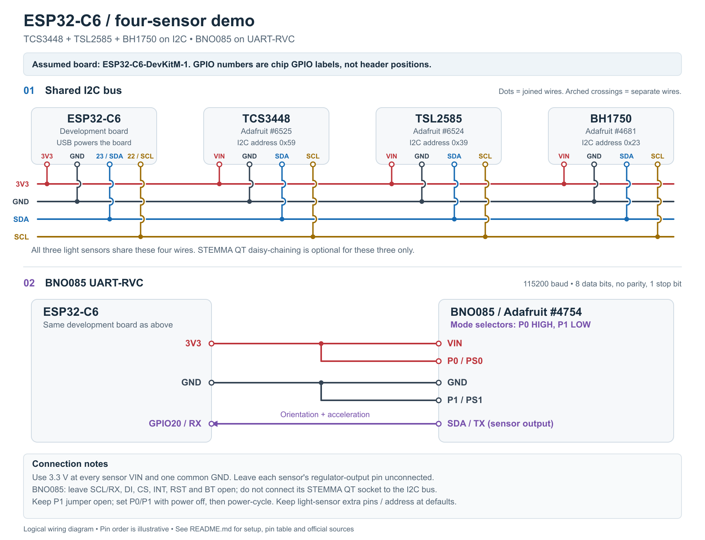

# ESP32-C6 four-sensor demonstration

Open `ESP32_FourSensorDemo/ESP32_FourSensorDemo.ino` in Arduino IDE. It reads all four sensors from `parts.txt` and prints labeled measurements once per second at **115200 baud**. The three light sensors share I2C; the **BNO085 uses UART-RVC**.

| Part from `parts.txt` | Sensor | Demo output | Interface |
| --- | --- | --- | --- |
| [Adafruit 6525](https://www.adafruit.com/product/6525) | TCS3448 | Visible/NIR spectral channels and clear channel, raw counts | I2C `0x59` |
| [Adafruit 6524](https://www.adafruit.com/product/6524) | TSL2585 | Photopic, infrared, and UVA counts normalized to 1x gain | I2C `0x39` |
| [Adafruit 4681](https://www.adafruit.com/product/4681) | BH1750 | Illuminance in lux | I2C `0x23` |
| [Adafruit 4754](https://www.adafruit.com/product/4754) | BNO085 | Yaw, pitch, roll in degrees; acceleration in m/s² | UART-RVC, 115200 8N1 |

`parts.txt` names the ESP32-C6-MINI-1 module, but not an exact development-board SKU. This project assumes the **Espressif ESP32-C6-DevKitM-1 with 4 MB flash**. On another board, confirm that GPIO20, GPIO22, and GPIO23 are exposed and available. The diagram uses GPIO labels, not physical header positions. See the [official board guide](https://docs.espressif.com/projects/esp-dev-kits/en/latest/esp32c6/esp32-c6-devkitm-1/user_guide.html).

## Wiring

View the [PNG diagram](docs/wiring.png) or the [scalable, printable SVG](docs/wiring.svg).



Disconnect USB power while wiring. Supply **every breakout VIN from ESP32 3V3**, and join all grounds. Use the breakout boards in the parts list, not bare sensor ICs. Leave their regulator-output pins (`3Vo`, `3V`, or `1Vo`, as labeled) unconnected. Use short jumper wires or STEMMA QT cables; the light-sensor boards already have I2C pull-ups.

| ESP32 connection | TCS3448 | TSL2585 | BH1750 | BNO085 |
| --- | --- | --- | --- | --- |
| **3V3** | VIN | VIN | VIN | VIN **and P0/PS0** |
| **GND** | GND | GND | GND | GND **and P1/PS1** |
| **GPIO23** (I2C SDA) | SDA | SDA | SDA | — |
| **GPIO22** (I2C SCL) | SCL | SCL | SCL | — |
| **GPIO20** (UART1 RX) | — | — | — | **SDA / UART TX** |

For the assumed DevKitM-1, GPIO23 is J3 pin 4, GPIO22 is J3 pin 5, and GPIO20 is J3 pin 7. Use the board's printed GPIO labels to avoid reversed-header counting. The header pin labeled simply `RX` is UART0/GPIO17; this sketch uses **GPIO20** for the sensor instead.

The three light sensors may be daisy-chained with STEMMA QT cables. Keep BH1750's address jumper at its default `0x23`, and leave the light sensors' optional interrupt/GPIO pins open. A breadboard, jumper wires, and/or a QT-to-header adapter are needed in addition to the listed boards.

For BNO085, use its header pins **or a separate QT-to-header breakout cable**, keeping it out of the light-sensor I2C chain. With a standard QT cable, connect **red to 3V3, black to GND, blue to GPIO20, and leave yellow disconnected**. In RVC mode, the blue SDA wire carries serial data out of the BNO085. Leave BNO085 SCL/RX, DI, CS, INT, RST, and BT open. There is no ESP32 TX wire.

**The four-wire QT cable does not configure the mode pins. Add a separate wire from BNO085 P0 to ESP32 3V3.** On the listed Adafruit board, P1 is pulled low by default, so it may stay unconnected with its **P1 solder jumper open**. The explicit P1-to-GND connection shown in the table and diagram is also valid, provided that jumper is open; a closed jumper ties P1 high. The P0 wire selects high without soldering its jumper. Alternatively, bridging only the P0 solder jumper selects high. After setting P0 high/P1 low, power-cycle the entire circuit so the BNO085 samples the mode selection. These settings select UART-RVC, which differs from the full SH-2 UART mode. See Adafruit's [mode table](https://learn.adafruit.com/adafruit-9-dof-orientation-imu-fusion-breakout-bno085/pinouts) and [UART-RVC wiring guide](https://learn.adafruit.com/adafruit-9-dof-orientation-imu-fusion-breakout-bno085/uart-rvc-for-arduino).

## Arduino IDE setup

1. Install **esp32 by Espressif Systems** in Boards Manager. The sketch was built with **3.3.12**. If needed, add Espressif's Boards Manager URL in Arduino Preferences: `https://espressif.github.io/arduino-esp32/package_esp32_index.json`. The [official Arduino-ESP32 installation instructions](https://docs.espressif.com/projects/arduino-esp32/en/latest/installing.html) explain this setup.
2. In Library Manager, install the libraries below. Accept **Install all dependencies** when prompted. Use the **BNO08x RVC** library for this sketch.
3. Open the `.ino` file inside `ESP32_FourSensorDemo`; keep `LightSensors.h` in that same folder.
4. Select **Tools → Board → ESP32 Arduino → ESP32C6 Dev Module**. Set **Flash Size: 4MB** and the default 4 MB partition scheme.
5. For the board's **native ESP32 USB port**, enable **USB CDC On Boot**. Alternatively, for the **USB-to-UART bridge port**, disable **USB CDC On Boot**. Select the port matching the connector you are using. UART1 for the BNO085 remains separate from either console choice.
6. Verify, upload, and open Serial Monitor at **115200 baud**. Press the ESP32 Reset button to see startup diagnostics. If upload cannot enter download mode, hold Boot, press and release Reset, then release Boot and retry.

| Library Manager name | Author | Version used for build |
| --- | --- | --- |
| Adafruit TCS3448 | Adafruit | 1.0.0 |
| Adafruit AS7343 (TCS3448 dependency) | Adafruit | 1.1.0 |
| Adafruit TSL2585 | Adafruit | 1.0.0 |
| BH1750 | Christopher Laws | 1.3.0 |
| Adafruit BNO08x RVC | Adafruit | 1.0.2 |
| Adafruit BusIO (dependency) | Adafruit | 1.17.4 |
| Adafruit Unified Sensor (declared RVC dependency) | Adafruit | Install when prompted |

The dedicated TCS3448 library is required; its dependency on AS7343 does not change the sensor's address to `0x39`. That address belongs to the TSL2585 in this circuit. Library APIs were checked against [TCS3448](https://github.com/adafruit/Adafruit_TCS3448), [TSL2585](https://github.com/adafruit/Adafruit_TSL2585), [BH1750](https://github.com/claws/BH1750), and [BNO08x RVC](https://github.com/adafruit/Adafruit_BNO08x_RVC).

## Run the demonstration

At startup the I2C scan should find **0x23, 0x39, and 0x59**. The BNO085 will not appear in that scan because it uses UART. Its presence is confirmed by valid serial packets, not merely by opening the UART.

- **BH1750:** cover and uncover the sensor or move a lamp closer. Its lux reading should change.
- **TCS3448:** try white, red, green, and blue light and compare the spectral channels. The onboard illumination LED stays off to avoid adding light to the other sensors. Fixed 16x gain and approximately 50 ms per SMUX cycle provide an indoor starting point. A full spectrum takes three cycles. If saturated, lower `TCS3448_GAIN_16X` in `LightSensors.h` or reduce the light intensity. Flicker measurement is not enabled.
- **TSL2585:** compare ambient lighting and daylight. UVA can be very low indoors. The output is gain-normalized counts at a 50 ms integration time; it is **not lux, UV index, or µW/cm²**. Automatic gain is enabled. A saturation label means the affected reading is clipped. [Adafruit's TSL2585 guide](https://learn.adafruit.com/adafruit-tsl2585-digital-uva-and-ambient-light-sensor)
- **BNO085:** tilt and rotate the board to see angles change, and move it to see acceleration change. Acceleration includes gravity, so a stationary board need not read zero. RVC provides this fixed set of reports; it does not expose separate magnetometer/gyroscope data or all the configurable SH-2 reports. Yaw is relative to reset, not a compass bearing. [BNO08x datasheet, section 1.2.5](https://www.ceva-ip.com/wp-content/uploads/BNO080_085-Datasheet.pdf)

Readings are acquired between the one-second printouts. A missing light sensor does not stop the others. Read errors retain the last good value with an error/age label; light data older than three seconds is marked `STALE`. BNO085 data older than 500 ms is reported as stale instead of printing old angles. After correcting wiring for a sensor missing at boot, reset the ESP32. After changing BNO085 mode straps, power-cycle both boards.

## Troubleshooting

| Symptom | Check |
| --- | --- |
| No Serial Monitor text | USB connector/port selection, USB CDC setting, data-capable cable, 115200 baud; press Reset. |
| No I2C sensors found | Common ground, 3V3 to VIN, GPIO23 to SDA, GPIO22 to SCL; check breadboard rail breaks. |
| Only one light sensor missing | Its power/cable, default address jumper, and correct part number/library. |
| BNO085 keeps waiting | P0 to 3V3; P1 low (default, jumper open); blue SDA/TX to **GPIO20**; red to 3V3 and black to GND; then power-cycle. See the [BNO085 troubleshooting guide](docs/BNO085_TROUBLESHOOTING.md). |
| Light values are frozen | Check the age/error labels and sensor connections. Reset after reconnecting. |
| Values saturate | Reduce light/gain. Raw spectral and TSL2585 counts cannot be compared directly with BH1750 lux. |

## Build verification and project files

The ESP32-C6 build check is recorded in [docs/validation.txt](docs/validation.txt). This is a compile check, not a test with connected sensors; actual readings and wiring still need a hardware run.

- `ESP32_FourSensorDemo/ESP32_FourSensorDemo.ino`: pin assignments, console, UART-RVC polling, and main loop.
- `ESP32_FourSensorDemo/LightSensors.h`: light-sensor setup, acquisition, and output.
- `docs/BNO085_TROUBLESHOOTING.md`: separate QT cable wiring, P0 mode correction, and diagnostic steps.
- `BNO085_Diagnostics/BNO085_Diagnostics.ino` and `RvcParser.h`: optional standalone UART byte/packet diagnostic; no sensor libraries required.
- `docs/wiring.svg` and `docs/wiring.png`: wiring diagram.
- `tools/generate_wiring.py`: regenerate the SVG using Python 3.
- `.build/`: local downloaded libraries and compiler output, excluded by `.gitignore`.

With the listed board core and libraries installed, an Arduino CLI build is:

```sh
arduino-cli compile --fqbn esp32:esp32:esp32c6:CDCOnBoot=cdc,FlashSize=4M ESP32_FourSensorDemo
```

Use `CDCOnBoot=default` for the USB-to-UART bridge console. The same pin constants apply to both builds.
